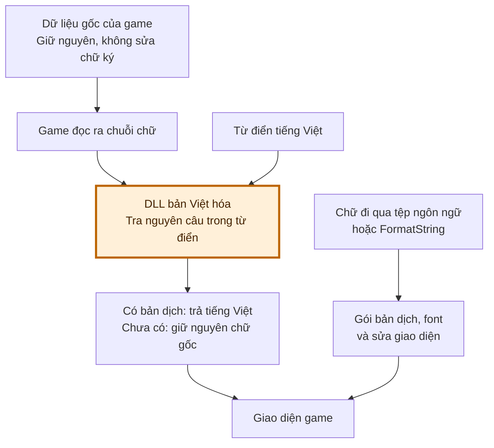

# WOJD Việt hóa

Bản Việt hóa cộng đồng, gồm bản dịch, font tiếng Việt và các sửa giao diện.

**[Tải VI_PATCH.zip](https://github.com/yakiro-nvg/wojd_trans/releases/latest/download/VI_PATCH.zip)** · [Xem bản phát hành](https://github.com/yakiro-nvg/wojd_trans/releases/latest)

> **Đọc kỹ rủi ro trước khi cài**
>
> Bản dịch nạp thêm DLL để thay chữ khi game đang chạy. Đây là can thiệp trực tiếp vào client, có thể gây lỗi mở game, văng game hoặc bị hệ thống chống gian lận cảnh báo/chặn.
>
> Chưa có xác nhận chấp thuận từ nhà phát hành. **Không thể cam kết an toàn tài khoản hay bảo đảm game luôn hoạt động ổn định.** Chỉ cài nếu bạn chấp nhận những rủi ro này.

## Vì sao phải dùng cách này?

Game dùng đường nạp văn bản riêng: nhiều nội dung, trong đó có kỹ năng và boss, không đi qua hệ thống ngôn ngữ chuẩn của Unreal. Cách cũ chỉ thay tệp ngôn ngữ nên không chèn được bản dịch vào những đường nạp này. Các tệp dữ liệu gốc lại được game kiểm tra chữ ký, nên cũng không thể chỉ sửa rồi chép đè.

Vì giới hạn đó, bản hiện tại phải thay chữ **sau khi game đọc dữ liệu lên**. Các tệp dữ liệu gốc được giữ nguyên; DLL tra nguyên câu trong từ điển rồi trả về bản tiếng Việt. Đây là lý do cần phương pháp can thiệp nêu trên, và cũng là nguồn rủi ro cần cân nhắc.

**Ô màu cam là phần can thiệp khi game đang chạy.** Luồng thay tệp ngôn ngữ vẫn được dùng cho các phần hỗ trợ nó; riêng các đường dữ liệu nêu trên cần DLL để chèn bản dịch.

## Cài đặt

1. Thoát game bình thường và tải **VI_PATCH.zip** ở liên kết phía trên.
2. Giải nén toàn bộ ZIP vào một thư mục riêng.
3. Chạy **install.bat**, rồi dán đường dẫn thư mục game khi được hỏi. [Hướng dẫn chọn thư mục](docs/getting-started-vi.md).
4. Mở game qua launcher như thường lệ. Nếu bản dịch yêu cầu mở lại game, thoát rồi mở lại.

Nếu game nằm trong **Program Files** hoặc thư mục bị Windows hạn chế quyền ghi, bạn có thể cần nhấp chuột phải **install.bat → Run as administrator**. Quyền này phụ thuộc nơi cài game và quyền ghi của tài khoản Windows.

Nếu từng dùng bản dịch cũ, chuyển các file bắt đầu bằng `~VI_PATCH` hoặc `~VI_QFONT` ra ngoài thư mục `Content\Paks` trước khi cài. Bản mới chỉ có một gói; không cài kèm LIM/QFONT cũ.

## Cập nhật, kiểm tra và gỡ

- **Cập nhật:** thoát game rồi chạy `install.bat` của gói mới.
- **Kiểm tra bản đã cài:** chạy `verify.bat`.
- **Gỡ bản dịch:** thoát game rồi chạy `uninstall.bat`.
- **Khôi phục một lần cài/gỡ:** chạy `rollback.bat` và nhập mã giao dịch mà bộ cài đã in ra.

Các thao tác kiểm tra/gỡ/khôi phục cũng cần quyền ghi phù hợp với thư mục game. Bộ cài không tự mở hay đóng game.

## Những điểm còn tồn đọng

Một số nội dung còn tiếng Trung hoặc dùng bản dịch cũ chưa được soát hết. Vài màn hình có thể còn tràn/cắt chữ ở những tỉ lệ giao diện chưa kiểm tra. Game cập nhật cũng có thể khiến bản dịch cần được chỉnh lại.

Khi [báo lỗi](https://github.com/yakiro-nvg/wojd_trans/issues), gửi tên bản phát hành, ảnh lỗi và thao tác để tái hiện. Kiểm tra thông tin riêng tư trước khi gửi log.

---

Dành cho người đóng góp: [Phát triển bản dịch](docs/contributing-vi.md) · [Phương pháp và giới hạn](docs/methodology.md) · [Build và phát hành](docs/release-process.md) · [Credit font](docs/font-credits.txt).
