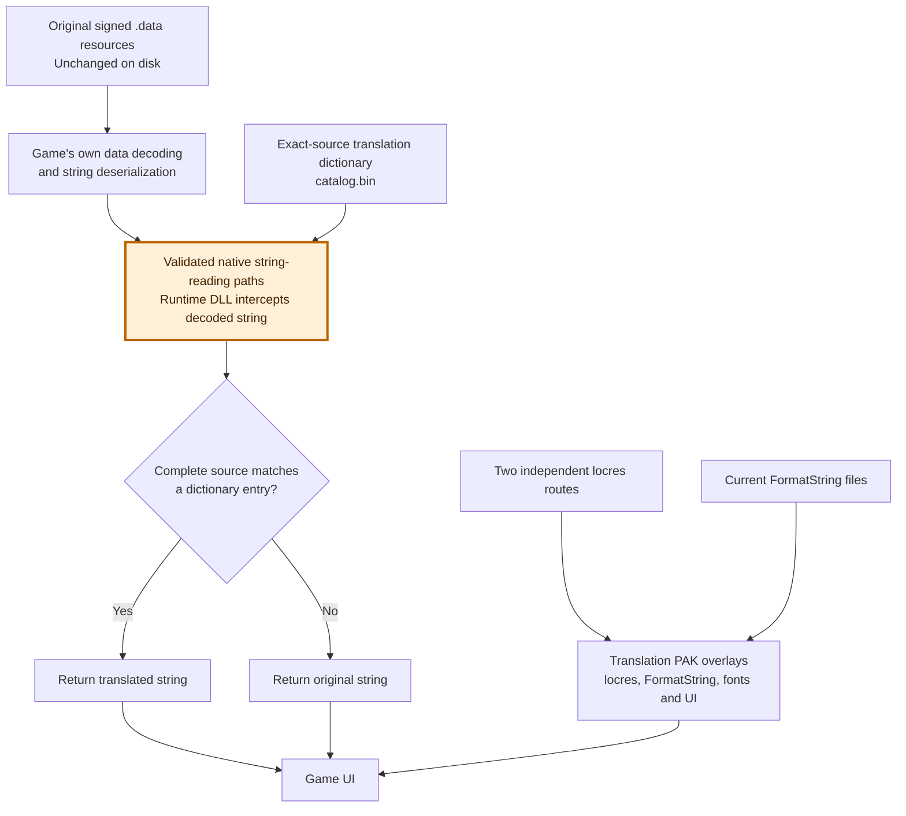

# Text sources and method

A substantial amount of text missing from shipped locres is present locally in .data resources inside PAKs. Runtime captures demonstrate this route for cards, quests and many other strings. This does not establish that every string is local or that the server never supplies text.

The shipped locres is not a complete source catalog. Local data can feed Unreal's text infrastructure at runtime; other display routes do not generate the same misses. Historical runtime identities are not treated as durable source IDs.

Direct .data replacement is unsuitable: the client validates signed resources using asymmetric cryptography, and these files also contain non-localization/gameplay parameters. Replacing an entire file risks retaining obsolete parameters across client updates. The project does not re-sign resources or disable integrity checks.

The solution used in this release is **runtime string substitution**. The signed .data files stay unchanged: the game reads and decodes its own data, then a native DLL intercepts the validated string-reading/deserialization paths. It compares the complete decoded source with a translation dictionary and, on a match, replaces the string returned to the game. This operates on string values rather than replacing whole data records or their numeric/gameplay parameters. Locres and FormatString overlays continue to handle text that follows those separate routes.

The validated string-assignment hook is enabled as soon as its allocator and dictionary are ready. At the decoder's first call, the hook checks its complete code signature, unwind owner and raw-reader callee before translating that string. It does not wait for the background discovery pass, which could otherwise miss dialogue records loaded during startup. Later discovery validates the exact assignment patch installed by this DLL; it rejects a different destination or changed body. Cached addresses remain hints, not authority to translate arbitrary callers.

These constraints explain why the native hook is needed. The legacy language-file approach cannot reach strings that bypass Unreal's localization path, so it cannot provide equivalent coverage for the observed data-reader and Skill/Buff paths. Loading and hooking native client code is a deeper intervention: it can break after updates or conflict with anti-cheat, and publisher acceptance or account safety cannot be guaranteed. The following section describes how substitution is constrained; it does not make the intervention risk-free.

The highlighted component runs inside the client. The resource overlays complement it; they do not make the native intervention unnecessary. This is a logical architecture diagram, not a claim that every producer or UI path has been covered.

## Runtime dictionary

The component observes the native route returning decoded .data strings and substitutes a translation only when the complete source matches the dictionary. Unmatched or ignored strings stay unchanged. It does not hook generic Lua string manipulation. This document intentionally omits low-level interception/reverse-engineering recipes.

There is no stable native field ID. Source changes stop matching automatically. The runtime compares full strings; editing-workflow hashes alone never authorize a replacement. Literal backslash-n, actual newlines, whitespace and markup remain distinct. Identical text used in multiple contexts currently receives one native translation, requiring editorial judgement where ambiguous.

Native states are translated, missing and ignore. Ignore is a persisted decision to keep Chinese. No native dated inference is made. Developer usage reports mark absent dictionary sources not_observed for their selected sessions/builds; they never automatically declare content dead or delete it. Release builds collect no per-string usage.

## Independent fallbacks

Fresh locres misses must be collected without translated locres on either resource route. Retain the actual namespace/key/source for each observation. Only an observed substituted native output is excluded; matching Chinese source text alone does not prove producer identity. Identical strings can occur independently in data and widgets.

Miss logs cannot recover already-resolved stock entries. The release therefore cooks two exact approved binding snapshots in resources/locres/, preserving namespace/key, authoritative source CRC and target for content and gamedata separately. Their full logical maps and compiled bytes are checked. Residual catalogs remain editorial inputs; legacy catalogs supply literal-source translation reuse, never arbitrary historical runtime IDs. Generated widget identities must be checked with their actual asset references. Whitespace, literal escapes and real newline forms are not normalized during this cook.

FormatString uses the current TXT sources, selecting patched whole files before sync. It preserves comments, encoding, BOM, line endings and key layout. File/key/source reconciliation is independent of native coverage. Here only, an unresolved source changed under the same file/key may be marked dated, because that identity is available. It stays Chinese. Rendering rejects source-file changes until a fresh synchronization.

## Quality and evidence

Structural checks preserve tags, logical attributes, placeholder order, numeric values and newline forms. Recognized link display text may change, while logical attributes remain exact. Structural QA does not prove linguistic correctness. Paths, internal identifiers and gameplay parameters are not automatically player text.

Two migration captures had identical source sets and counters on the tested build. This supports repeatability for those runs, not universal coverage. Each developer run needs its own build metadata, readiness/counter review and archive result; menu-specific validation remains necessary.

## Tóm tắt

Nhiều text thiếu trong locres thực ra nằm ở .data local trong PAK. Không ghi đè cả file vì chữ ký bất đối xứng và rủi ro tham số cũ lệch bản game. Hook chỉ thay kết quả chuỗi khi khớp nguyên source. Locres dùng binding riêng cho hai route; miss log sạch bổ sung chứng cứ, không thay toàn bộ stock IDs. FormatString đối chiếu riêng; NDJSON cũ dùng để reuse câu dịch.
